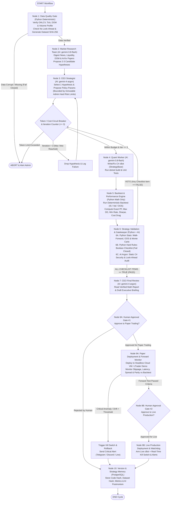
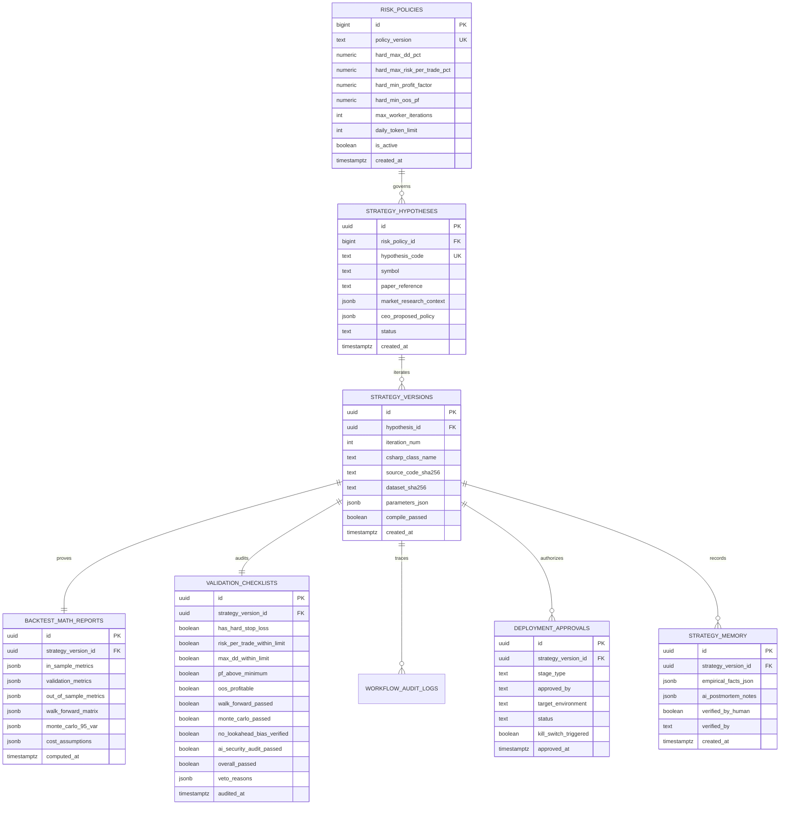

# 🏛️ Antigravity Trading Platform (V2) — Enterprise Architecture & Engineering Blueprint
**Paradigm:** `Build (AI) ➔ Prove (Math/Stats) ➔ Protect (Deterministic Rules)`

> [!IMPORTANT]
> **Pre-Implementation Governance Gate (Section 6 Compliance):**
> เอกสารฉบับนี้จัดทำขึ้นตามข้อกำหนด **Section 6 (Required Deliverables)** และ **Action Item** โดย **ยังไม่มีการแก้ไขซอร์สโค้ดเดิมใน Repository** จนกว่าคุณจะตรวจสอบและกดอนุมัติแผนงานนี้ (**Proceed**)

---

## 1. Current Architecture Audit (ตรวจสอบระบบเดิมและจุดที่ต้องปรับปรุง)

จากการตรวจสอบโครงสร้างไฟล์จริงในโปรเจกต์ [d:/cbot-atgvt](file:///d:/cbot-atgvt) พบสถานะของระบบปัจจุบันดังนี้:

| โมดูลเดิมใน Repository | ไฟล์สำคัญ | สถานะการประเมิน (Audit Status) | แนวทางจัดการใน V2 (Migration Action) |
| :--- | :--- | :--- | :--- |
| **C# Execution & Recorder Engine** | [BacktestLab.cs](file:///d:/cbot-atgvt/cbot/BacktestLab/BacktestLab.cs), [StrategyBase.cs](file:///d:/cbot-atgvt/cbot/BacktestLab/StrategyBase.cs), [LiveRecorder.cs](file:///d:/cbot-atgvt/cbot/BacktestLab/LiveRecorder.cs), [FlowTracker.cs](file:///d:/cbot-atgvt/cbot/BacktestLab/FlowTracker.cs) | ทำงานได้สมบูรณ์ คอมไพล์ผ่าน `dotnet build` (`0 Error`) และบันทึก DOM/Tick สดได้จริง | **Keep & Protect (ห้ามรื้อ):** รักษาความเข้ากันได้ 100% โดยแยกส่วน Execution ออกจากฝั่งวิเคราะห์อย่างเด็ดขาด |
| **Database (Supabase / PostgreSQL)** | [schema.sql](file:///d:/cbot-atgvt/supabase/schema.sql), [2026-10-04-backtest-jobs.sql](file:///d:/cbot-atgvt/supabase/migrations/2026-10-04-backtest-jobs.sql) | มีตาราง `strategies`, `backtest_runs`, `backtest_jobs` พร้อม RLS แล้ว แต่ยังขาดตารางเก็บ Audit Trail รายโหนด, Risk Policy Versioning และ Strategy Memory | **Extend (สร้าง Migration ต่อยอด):** เพิ่มตาราง V2 โดยไม่กระทบตารางเดิม |
| **Quant Fund V1 Prototype** | [graph.py](file:///d:/cbot-atgvt/quant_fund/graph.py), [agents.py](file:///d:/cbot-atgvt/quant_fund/agents.py), [tools.py](file:///d:/cbot-atgvt/quant_fund/tools.py), [schemas.py](file:///d:/cbot-atgvt/quant_fund/schemas.py) | มีเพียง 5 โหนด, ยังใช้คะแนน `risk_score (0-100)`, ยังไม่มี Data Quality Gate, Walk-Forward/Monte Carlo, Token Circuit Breaker และการแยก Paper vs Live HITL | **Refactor to V2 Modular Package:** แยกเป็นโมดูล `research`, `quant`, `validation`, `risk`, `execution`, `db` ตามสถาปัตยกรรม 10 โหนด |

---

## 2. LangGraph V2 Architecture Diagram (10-Node Pipeline + Dual HITL + Circuit Breaker)



---

## 3. Database ER Diagram & PostgreSQL Schema (Strategy Memory & Full Auditability)

ออกแบบให้เชื่อมต่อกับ PostgreSQL / Supabase เดิม ([supabase/schema.sql](file:///d:/cbot-atgvt/supabase/schema.sql)) โดยแยก **ข้อเท็จจริงทางคณิตศาสตร์ (`empirical_facts`)** ออกจาก **ข้อสังเกตของ AI (`ai_learnings`)** อย่างเด็ดขาด:



### SQL DDL สำหรับสร้างตารางใหม่ (`supabase/migrations/2026-11-02-quant-fund-v2.sql`)

```sql
-- 1. Immutable Risk Policies (แก้ไขได้เฉพาะ System Admin เท่านั้น ห้าม AI แก้ไข)
CREATE TABLE IF NOT EXISTS public.risk_policies (
    id                          BIGINT GENERATED ALWAYS AS IDENTITY PRIMARY KEY,
    policy_version              TEXT NOT NULL UNIQUE,           -- เช่น 'RISK-POL-V2.0'
    hard_max_dd_pct             NUMERIC NOT NULL DEFAULT 18.0,  -- Max Drawdown สูงสุดที่ยอมรับได้ (%)
    hard_max_risk_per_trade_pct NUMERIC NOT NULL DEFAULT 2.0,   -- ความเสี่ยงต่อไม้สูงสุด (%)
    hard_min_profit_factor      NUMERIC NOT NULL DEFAULT 1.15,  -- PF ขั้นต่ำหลังหักต้นทุนจริง
    hard_min_oos_pf             NUMERIC NOT NULL DEFAULT 1.10,  -- Out-of-Sample PF ขั้นต่ำ
    hard_max_mc_ruin_prob_pct   NUMERIC NOT NULL DEFAULT 1.0,   -- โอกาสล้างพอร์ตจาก Monte Carlo (%)
    max_worker_iterations       INT NOT NULL DEFAULT 3,         -- ลิมิตการแก้โค้ดต่อสมมติฐาน
    daily_token_limit           INT NOT NULL DEFAULT 500000,    -- Circuit Breaker ตัดเมื่อใช้ Token เกินต่อวัน
    daily_cost_limit_usd        NUMERIC NOT NULL DEFAULT 5.00,  -- Circuit Breaker ตัดเมื่อค่า API เกิน ($)
    created_by                  TEXT NOT NULL DEFAULT 'SYSTEM_ADMIN',
    is_active                   BOOLEAN NOT NULL DEFAULT TRUE,
    created_at                  TIMESTAMPTZ NOT NULL DEFAULT NOW()
);

-- 2. Strategy Hypotheses (บันทึกสมมติฐานจาก Market Research & CEO)
CREATE TABLE IF NOT EXISTS public.strategy_hypotheses (
    id                      UUID PRIMARY KEY DEFAULT gen_random_uuid(),
    risk_policy_id          BIGINT NOT NULL REFERENCES public.risk_policies(id),
    hypothesis_code         TEXT NOT NULL UNIQUE,
    symbol                  TEXT NOT NULL,
    paper_reference         TEXT,
    market_research_context JSONB NOT NULL DEFAULT '{}',
    ceo_proposed_policy     JSONB NOT NULL DEFAULT '{}',
    status                  TEXT NOT NULL DEFAULT 'IN_PROGRESS', -- IN_PROGRESS / DROPPED / PAPER_TESTING / LIVE / RETIRED
    created_at              TIMESTAMPTZ NOT NULL DEFAULT NOW()
);

-- 3. Strategy Versions (ผูก Hash ของ C# Code และ Dataset ทุก Iteration)
CREATE TABLE IF NOT EXISTS public.strategy_versions (
    id                 UUID PRIMARY KEY DEFAULT gen_random_uuid(),
    hypothesis_id      UUID NOT NULL REFERENCES public.strategy_hypotheses(id) ON DELETE CASCADE,
    iteration_num      INT NOT NULL CHECK (iteration_num BETWEEN 1 AND 3),
    csharp_class_name  TEXT NOT NULL,
    csharp_file_path   TEXT NOT NULL,
    source_code_sha256 TEXT NOT NULL,
    dataset_sha256     TEXT NOT NULL,
    parameters_json    JSONB NOT NULL DEFAULT '{}',
    compile_passed     BOOLEAN NOT NULL DEFAULT FALSE,
    unit_test_passed   BOOLEAN NOT NULL DEFAULT FALSE,
    created_at         TIMESTAMPTZ NOT NULL DEFAULT NOW(),
    UNIQUE (hypothesis_id, iteration_num)
);

-- 4. Deterministic Backtest Math Reports (คำนวณด้วย Python Math ล้วน ห้าม LLM คำนวณ)
CREATE TABLE IF NOT EXISTS public.backtest_math_reports (
    id                     UUID PRIMARY KEY DEFAULT gen_random_uuid(),
    strategy_version_id    UUID NOT NULL UNIQUE REFERENCES public.strategy_versions(id) ON DELETE CASCADE,
    cost_assumptions       JSONB NOT NULL, -- {"spread": 0.20, "commission": 0.07, "swap_long": -0.12, "slippage": 0.05}
    in_sample_metrics      JSONB NOT NULL, -- 2022-01 ถึง 2024-06
    validation_metrics     JSONB NOT NULL, -- 2024-07 ถึง 2025-06
    out_of_sample_metrics  JSONB NOT NULL, -- 2025-07 ถึง 2026-10 (Unseen Holdout)
    walk_forward_matrix    JSONB NOT NULL, -- ผลการทดสอบ Rolling Walk-Forward
    monte_carlo_summary    JSONB NOT NULL, -- 1,000 runs: 95% Worst DD, 95% VaR, Ruin Prob
    parameter_sensitivity  JSONB NOT NULL, -- ผลกระทบเมื่อขยับพารามิเตอร์ +/- 10%
    computed_at            TIMESTAMPTZ NOT NULL DEFAULT NOW()
);

-- 5. Gatekeeper Boolean Checklist Validation (แทนระบบคะแนน 100/100 เดิม)
CREATE TABLE IF NOT EXISTS public.validation_checklists (
    id                           UUID PRIMARY KEY DEFAULT gen_random_uuid(),
    strategy_version_id          UUID NOT NULL UNIQUE REFERENCES public.strategy_versions(id) ON DELETE CASCADE,
    has_hard_stop_loss           BOOLEAN NOT NULL DEFAULT FALSE,
    risk_per_trade_within_limit  BOOLEAN NOT NULL DEFAULT FALSE,
    max_dd_within_limit          BOOLEAN NOT NULL DEFAULT FALSE,
    pf_above_minimum             BOOLEAN NOT NULL DEFAULT FALSE,
    oos_profitable               BOOLEAN NOT NULL DEFAULT FALSE,
    walk_forward_passed          BOOLEAN NOT NULL DEFAULT FALSE,
    monte_carlo_passed           BOOLEAN NOT NULL DEFAULT FALSE,
    no_lookahead_bias_verified   BOOLEAN NOT NULL DEFAULT FALSE,
    ai_security_audit_passed     BOOLEAN NOT NULL DEFAULT FALSE,
    overall_passed               BOOLEAN GENERATED ALWAYS AS (
        has_hard_stop_loss AND risk_per_trade_within_limit AND max_dd_within_limit AND
        pf_above_minimum AND oos_profitable AND walk_forward_passed AND
        monte_carlo_passed AND no_lookahead_bias_verified AND ai_security_audit_passed
    ) STORED,
    veto_reasons                 JSONB NOT NULL DEFAULT '[]',
    ai_auditor_model             TEXT NOT NULL,
    audited_at                   TIMESTAMPTZ NOT NULL DEFAULT NOW()
);

-- 6. Node-Level Workflow Audit Logs & Token/Cost Tracking
CREATE TABLE IF NOT EXISTS public.workflow_audit_logs (
    id                  BIGINT GENERATED ALWAYS AS IDENTITY PRIMARY KEY,
    hypothesis_id       UUID REFERENCES public.strategy_hypotheses(id) ON DELETE CASCADE,
    strategy_version_id UUID REFERENCES public.strategy_versions(id) ON DELETE SET NULL,
    node_name           TEXT NOT NULL,
    agent_model         TEXT NOT NULL,          -- 'PYTHON_DETERMINISTIC' / 'gemini-3.8-flash' / 'gemini-4-argon'
    prompt_version      TEXT NOT NULL,
    policy_version      TEXT NOT NULL,
    input_payload       JSONB NOT NULL DEFAULT '{}',
    output_payload      JSONB NOT NULL DEFAULT '{}',
    tokens_used         INT NOT NULL DEFAULT 0,
    estimated_cost_usd  NUMERIC NOT NULL DEFAULT 0.0,
    verdict             TEXT,                   -- 'PASS' / 'VETO' / 'INFO' / 'ABORT'
    verdict_reasons     JSONB NOT NULL DEFAULT '[]',
    executed_at         TIMESTAMPTZ NOT NULL DEFAULT NOW()
);

-- 7. Two-Stage Human-in-the-Loop Deployment Approvals
CREATE TABLE IF NOT EXISTS public.deployment_approvals (
    id                     UUID PRIMARY KEY DEFAULT gen_random_uuid(),
    strategy_version_id    UUID NOT NULL REFERENCES public.strategy_versions(id),
    stage_type             TEXT NOT NULL CHECK (stage_type IN ('PAPER_TRADING', 'LIVE_TRADING')),
    approved_by            TEXT NOT NULL,
    target_environment     TEXT NOT NULL,       -- 'CLOUD_VM_HEADLESS_DEMO' / 'CTRADER_LIVE_ACCOUNT'
    forward_test_days      INT DEFAULT 0,
    forward_vs_bt_drift    NUMERIC DEFAULT 0.0,
    kill_switch_triggered  BOOLEAN NOT NULL DEFAULT FALSE,
    rollback_reason        TEXT,
    approved_at            TIMESTAMPTZ NOT NULL DEFAULT NOW()
);

-- 8. Strategy Memory (แยก Empirical Facts ออกจาก AI Recommendations อย่างชัดเจน)
CREATE TABLE IF NOT EXISTS public.strategy_memory (
    id                    UUID PRIMARY KEY DEFAULT gen_random_uuid(),
    strategy_version_id   UUID NOT NULL REFERENCES public.strategy_versions(id) ON DELETE CASCADE,
    symbol                TEXT NOT NULL,
    market_regime         TEXT NOT NULL,
    empirical_facts_json  JSONB NOT NULL,       -- ตัวเลขจริงจาก Python Math Engine เท่านั้น (Immutable Fact)
    ai_postmortem_notes   JSONB NOT NULL,       -- ข้อสังเกต/บทเรียนที่สกัดโดย AI (Untrusted until verified)
    verified_by_human     BOOLEAN NOT NULL DEFAULT FALSE, -- ห้ามนำ AI note ไปปรับกลยุทธ์จริงถ้าเป็น FALSE
    verified_by           TEXT,
    created_at            TIMESTAMPTZ NOT NULL DEFAULT NOW()
);
```

---

## 4. Node Specifications & `FundStateV2` Schema (รายละเอียดทั้ง 10 โหนด)

| ลำดับ | ชื่อโหนด (LangGraph Node) | ผู้ประมวลผล (Engine) | หน้าที่หลักและเกณฑ์ตัดสิน (Fail-Closed Logic) |
| :---: | :--- | :---: | :--- |
| **1** | `data_quality_gate` | **Python Deterministic** | ตรวจความสมบูรณ์ของ OHLCV, Tick, DOM และ Volume Profile (ห้ามมี Timestamp ย้อนกลับ, ห้ามมี NaN/Zero Spike, ตรวจช่องว่างข้อมูล) พร้อมคำนวณ `dataset_sha256` หากไม่ผ่านให้หยุดทันที (`Fail Closed`) |
| **2** | `market_research_team` | **AI (`gemini-3.8-flash`)** | ย่อยข้อมูลตารางข่าวเศรษฐกิจ (`events.csv`), สภาพคล่อง DOM ล่าสุด และคลังงานวิจัย [strategies_database.json](file:///d:/cbot-atgvt/zz_zz%20PAPER/strategies_database.json) เพื่อเสนอสมมติฐาน 2–3 ทางเลือกในรูปแบบ JSON |
| **3** | `ceo_strategist` | **AI (`gemini-4-argon`)** | เลือก 1 สมมติฐานจากข้อ 2 และกำหนด Policy Parameters โดยระบบจะบังคับเปรียบเทียบกับ `risk_policies` (CEO ไม่มีสิทธิ์ตั้งค่าเกิน Hard Limit ของ Admin) |
| **4** | `quant_worker` | **AI (`gemini-3.8-flash`)** | เขียน/แก้ไขโค้ด C# cBot (สืบทอด `StrategyBase`), คำนวณ `source_code_sha256`, รัน `dotnet build` และรัน Unit Test เบื้องต้น |
| **5** | `backtest_math_engine` | **Python Deterministic** | รัน Backtest แยก 3 ช่วงชัดเจน: **In-Sample** (พัฒนากฎ), **Validation** (ปรับจูน), และ **Out-of-Sample** (วัดผลครั้งสุดท้าย) รวมค่า Spread, Commission, Swap และ Slippage คำนวณด้วยสูตรคณิตศาสตร์ Python 100% |
| **6** | `strategy_validation_gatekeeper` | **Python Math + AI (`gemini-4-argon`)** | **6A (Python Stats):** รัน Walk-Forward Matrix, Parameter Sensitivity ($\pm 10\%$) และ Monte Carlo 1,000 รอบ<br/>**6B (Python Rules):** ตรวจ Boolean Checklist 8 ข้อ (Fail-Closed)<br/>**6C (AI Argon):** ตรวจ Static C# Security Audit (Look-ahead `.Last(0)`, Infinite Loop, Unhandled Exception)<br/>*หากข้อใดข้อหนึ่งเป็น `FALSE` สั่ง **VETO** กลับไป Node 4 (สูงสุดไม่เกิน 3 รอบ)* |
| **7** | `ceo_final_review` | **AI (`gemini-4-argon`)** | อ่านผลลัพธ์จาก `backtest_math_reports` และ `validation_checklists` ที่ผ่านครบทุกข้อแล้ว มาสรุปเป็นรายงาน **Executive Briefing** เสนอมนุษย์ |
| **8** | `human_approval_gate` | **Human-in-the-Loop** | แบ่งเป็น **Gate 8A (Approve to Paper Trading บน Cloud VM Headless)** และ **Gate 8B (Approve to Live Production)** หลังผ่าน Forward Test ตามเกณฑ์ |
| **9** | `deployment_and_monitoring` | **System + Watchdog** | ซิงก์ C# cBot และเปิดโปรเซสเฝ้าระวังแบบเรียลไทม์ (ตรวจ Order Rejection, Slippage, Spread, Latency, Position Mismatch, Missing SL/TP) หากผิดปกติวิกฤตให้สั่ง **Kill Switch** และส่งแจ้งเตือนผ่าน **Telegram / Discord / Line** ทันที |
| **10** | `strategy_memory_db` | **PostgreSQL Service** | บันทึก Hash, พารามิเตอร์, ผลสถิติ และแยก `empirical_facts_json` ออกจาก `ai_postmortem_notes` ลงฐานข้อมูล PostgreSQL |

---

## 5. Risk Policy Specification (Fail-Closed & Checklist Validation)

### 5.1 การแยกสิทธิ์ระหว่าง Admin Hard Limits กับ CEO Policy
- **System Admin Hard Limits (`risk_policies` table):** แก้ไขได้เฉพาะผู้ดูแลระบบผ่านไฟล์ตั้งค่าที่ล็อกสิทธิ์หรือฐานข้อมูลโดยตรง โมเดล AI ทุกตัวมีสิทธิ์อ่านอย่างเดียว (`Read-Only`)
- **Fail-Closed Guarantee:** หากฟังก์ชันคำนวณความเสี่ยงเกิด Exception, คืนค่า `NaN`/`None`, หรือไฟล์ข้อมูลขาดหาย ระบบจะตัดสินเป็น `VETO / REJECT` ทันทีโดยอัตโนมัติ

### 5.2 ตาราง Checklist Validation (ยกเลิกระบบคะแนน 100/100)
กลยุทธ์จะผ่าน Node 6 ไปยัง Node 7 ได้ **ต้องได้ค่า `TRUE` ครบทั้ง 9 ข้อเท่านั้น**:

| รหัส | รายการตรวจสอบ (Validation Gate) | ผู้ตรวจสอบ | เงื่อนไขผ่านเกณฑ์ (`TRUE`) |
| :---: | :--- | :---: | :--- |
| **CHK-01** | `has_hard_stop_loss` | Python AST/Regex | มี `override double? StopDistance` ที่คืนค่าระยะตัดขาดทุนจริง $> 0$ เสมอ และห้ามมี Martingale/Grid ซ้อนไม้ |
| **CHK-02** | `risk_per_trade_within_limit` | Python Math | ความเสี่ยงสูงสุดต่อไม้ $\le$ `hard_max_risk_per_trade_pct` (เช่น $\le 2.0\%$ ของพอร์ต) |
| **CHK-03** | `max_dd_within_limit` | Python Math | Max Drawdown ทั้งใน IS, Val และ OOS $\le$ `hard_max_dd_pct` (เช่น $\le 18.0\%$) |
| **CHK-04** | `pf_above_minimum` | Python Math | Profit Factor สุทธิหลังหัก Spread + Commission + Swap + Slippage $\ge 1.15$ |
| **CHK-05** | `oos_profitable` | Python Math | ผลทดสอบช่วง Out-of-Sample (Unseen Data) มี Profit Factor $\ge 1.10$ และ Net PnL $> 0$ |
| **CHK-06** | `walk_forward_passed` | Python Math | ผ่านเกณฑ์ Walk-Forward Efficiency (มีกำไรสุทธิอย่างน้อย $75\%$ ของหน้าต่างทดสอบย่อย) |
| **CHK-07** | `monte_carlo_passed` | Python Math | Monte Carlo 1,000 รอบ (สลับลำดับเทรด + สุ่ม Slippage) มีโอกาสเกิด Ruin $\le 1.0\%$ และ 95th Percentile DD $\le 22.0\%$ |
| **CHK-08** | `no_lookahead_bias_verified` | Python + AI Argon | ใช้เฉพาะแท่งเทียนที่ปิดสมบูรณ์แล้ว (`.Last(1)` หรือ `Count - 2`) และไม่มีการรั่วไหลของข้อมูลอนาคต |
| **CHK-09** | `ai_security_audit_passed` | AI (`gemini-4-argon`) | ไม่พบช่องโหว่การส่งคำสั่งซ้ำรัวๆ (Order Spamming), ตรวจสอบ `MaxPositions == 1` และจัดการ Error ครบถ้วน |

---

## 6. Testing, Execution Monitoring & Acceptance Criteria

1. **Unit & Integration Tests (`tests/`):**
   - `test_data_quality.py`: ทดสอบการดักจับข้อมูลขาดหาย, Timestamp ซ้ำ/ย้อนกลับ และค่าสเปรดติดลบ
   - `test_risk_engine_fail_closed.py`: ทดสอบว่าเมื่อส่งค่า `NaN`, `None`, หรือ Drawdown เกินแม้แต่ $0.01\%$ ระบบต้องคืนค่า `VETO` เสมอ
   - `test_iteration_and_circuit_breaker.py`: ทดสอบว่าเมื่อถูก VETO ครบ 3 รอบ หรือใช้ Token เกิน `daily_token_limit` กราฟต้องตัดการทำงานทันที
2. **Baseline Parity Verification:**
   - รันเปรียบเทียบผลลัพธ์ของกลยุทธ์มาตรฐาน ([QuantExtremeReversal.cs](file:///d:/cbot-atgvt/cbot/BacktestLab/Strategies/QuantExtremeReversal.cs) และ [QuantAuctionValue.cs](file:///d:/cbot-atgvt/cbot/BacktestLab/Strategies/QuantAuctionValue.cs)) บนเครื่องยนต์ใหม่เทียบกับ Baseline เดิมเพื่อยืนยันความถูกต้องของสูตรคณิตศาสตร์
3. **Real-Time Execution Monitoring & Multi-Channel Alerting:**
   - โมดูล `execution_monitor.py` อ่านข้อมูลสดจาก `%LOCALAPPDATA%\BacktestLab\live` และตรวจสอบ:
     - `Actual Slippage > 2.0x Backtest Slippage`
     - `Open Position without SL/TP` หรือ `Position Size Mismatch`
     - `Heartbeat Stale > 120 seconds` (Connection Failure)
   - เมื่อพบความผิดปกติระดับวิกฤต จะสั่งเปิด **Kill Switch** (หยุดเปิดไม้ใหม่ทันที) และยิงแจ้งเตือนผ่าน Webhook (**Telegram Bot API / Discord Webhook / Line Messaging API**) ตามที่ตั้งค่าไว้ใน `.env`

---

## 7. Phased Implementation & Migration Plan (แผนการแบ่งเฟสพัฒนาอย่างปลอดภัย)

เพื่อไม่ให้กระทบระบบเก็บข้อมูล DOM สดที่กำลังรันอยู่ เราแบ่งการพัฒนาออกเป็น **4 เฟสชัดเจน**:

- **Phase 1: Deterministic Python Validation & Risk Core (`quant_fund_v2/core/`)**
  - สร้าง Node 1 (`data_quality.py`), Node 5 (`backtest_engine.py` พร้อม IS/Val/OOS, Swap, Slippage), และ Node 6A/6B (`validation_engine.py` สำหรับ Walk-Forward, Monte Carlo, และ Fail-Closed Checklist) พร้อมชุด Unit Tests ครบทุกฟังก์ชัน
- **Phase 2: PostgreSQL Strategy Memory & Token Circuit Breaker (`quant_fund_v2/db/`)**
  - สร้างไฟล์ Migration [2026-11-02-quant-fund-v2.sql](file:///d:/cbot-atgvt/supabase/migrations/) และเซอร์วิสเชื่อมต่อ PostgreSQL / Local SQLite Fallback พร้อมระบบนับ Token และ Cost Circuit Breaker
- **Phase 3: LangGraph V2 10-Node Pipeline & Dual-Stage HITL (`quant_fund_v2/graph.py`)**
  - ผูกโหนดทั้ง 10 ขั้นตอนเข้ากับ `StateGraph`, จำกัดลูป VETO ไม่เกิน 3 รอบต่อสมมติฐาน และแยกด่านอนุมัติ `interrupt_before=["deploy_paper_trading", "deploy_live_trading"]`
- **Phase 4: Execution Monitoring Daemon, Kill Switch & Alerting (`quant_fund_v2/monitoring/`)**
  - สร้างระบบติดตามผลการเทรดจริงเทียบกับ Backtest (Drift Detection), ปุ่มฉุกเฉิน Kill Switch และระบบส่งแจ้งเตือนผ่าน Telegram / Discord / Line

---

## ข้อตัดสินใจเพื่อเริ่มดำเนินการ (Next Steps Approval)

1. **อนุมัติแผนสถาปัตยกรรม V2:** คุณสามารถกดปุ่ม **Proceed** บนเอกสารนี้เพื่ออนุมัติให้เริ่มพัฒนาตั้งแต่ **Phase 1** เป็นต้นไป
2. **ช่องทางแจ้งเตือนหลัก (Notification Channel สำหรับหัวข้อ 4.5):** คุณต้องการให้ตั้งค่าเริ่มต้นของการแจ้งเตือนฉุกเฉินเป็น **Telegram**, **Discord Webhook**, หรือ **Line** ครับ?
