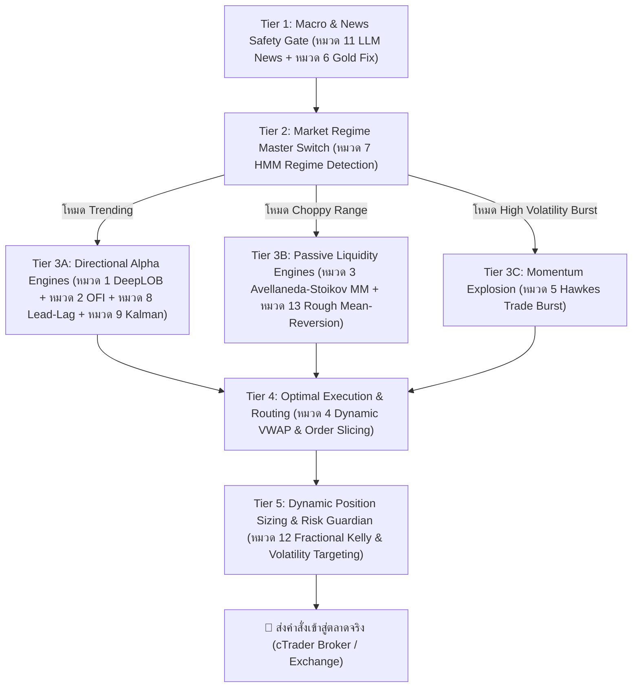

# 🧩 การวิเคราะห์การผสานรวมกลยุทธ์ทั้งหมด (Multi-Strategy Ensemble & Synthesis Analysis)

> **คำถามสำคัญ:** *"สามารถนำทุกกลยุทธ์ทั้ง 141 งานวิจัย (13 หมวดหมู่) มาใช้พร้อมกันได้หรือไม่?"*

---

## 🎯 คำตอบเชิงสถาปัตยกรรม (Architectural Verdict)

> **"สามารถนำมาใช้งานร่วมกันได้ทั้งหมด แต่ต้องไม่เปิดให้ทุกกลยุทธ์ยิงออเดอร์พร้อมกันอย่างอิสระเด็ดขาด"**

หากนำกลยุทธ์ทั้งหมดมาเปิดเทรดพร้อมกันในบัญชีเดียวโดยไม่มีระบบควบคุม จะเกิด **"หายนะการชนกันของสัญญาณ" (Signal Cannibalization):**
* ตัวอย่าง: กลยุทธ์ *Trend Following (หมวด 9 Kalman)* สั่ง **BUY** แต่กลยุทธ์ *Market Making / Mean Reversion (หมวด 3 และ 13)* สั่ง **SELL** ที่ราคาเดียวกัน
* ผลลัพธ์: เสียค่าสเปรดและคอมมิชชัน 2 ต่อทันทีโดยไม่ได้กำไร (Churning Fees)

### 💡 วิธีแก้ระดับสถาบัน: จัดโครงสร้างเป็น "สถาปัตยกรรมแบบลำดับชั้น 5 ระดับ" (5-Tier Quantitative Pipeline)
แทนที่จะมองว่าทั้ง 141 เปเปอร์คือ "บอท 141 ตัว" ให้มองว่าพวกมันคือ **"ชิ้นส่วนอวัยวะ"** ในสิ่งมีชีวิตเดียวกัน ดังนี้:

---

## 🏗️ โครงสร้าง 5-Tier Quantitative Pipeline

---

## 🔍 รายละเอียดการทำงานของแต่ละ Tier (How They Work in Synergy)

### 🛑 Tier 1: Macro & News Safety Gate (ผู้เฝ้าประตูป้องกันความเสี่ยง)
* **กลยุทธ์ที่รับผิดชอบ:** หมวด 11 (Financial LLMs & News Sentiment) และ หมวด 6 (Gold Intraday Fix)
* **หน้าที่:** ตรวจสอบกระแสข่าวแบบ Real-time ก่อนที่สัญญาณอื่นจะทำงาน
  * หากมีข่าวดอกเบี้ย FOMC, ตัวเลขเงินเฟ้อ CPI หรือ Non-Farm Payrolls กำลังจะประกาศภายใน 15 นาที -> **สั่งระงับการทำงานของทุกบอททันที**
  * หากโมเดล LLM ตรวจพบ Sentiment ข่าวฉับพลันที่มีคะแนนรุนแรง ($|S| > 0.8$) -> สั่งให้บอทเปิดโหมดเตรียมรับแรงกระแทก

---

### 🎛️ Tier 2: Market Regime Master Switch (สวิตช์คุมสภาวะตลาด)
* **กลยุทธ์ที่รับผิดชอบ:** หมวด 7 (Hidden Markov Models - HMM) และ หมวด 10 (Diffusion Scenario Simulation)
* **หน้าที่:** เป็น "สมองส่วนกลาง" วิเคราะห์สถิติกราฟว่าตลาดกำลังอยู่ในสภาวะใด จาก 3 สภาวะ:
  1. **สภาวะมีแนวโน้ม (Trending Regime):** อนุญาตให้เฉพาะ *Tier 3A (Directional Alpha)* ทำงานเท่านั้น สั่งปิดโหมด Market Making ทันที
  2. **สภาวะแกว่งตัวในกรอบ (Range-Bound / Low-Vol):** อนุญาตให้เฉพาะ *Tier 3B (Passive Liquidity)* ทำงาน เพื่อเก็บค่าสเปรด ห้ามรัน Trend Following
  3. **สภาวะวิกฤติผันผวนสูง (Turbulent / Crisis Regime):** สั่งลดขนาดไม้ลง 80% หรือถือเงินสด 100%

---

### ⚡ Tier 3: Alpha Signal Generation (กองกำลังสร้างสัญญาณซื้อขาย)
ทำงานตามคำสั่งของ Tier 2 โดยไม่ตีกันเอง:
* **ชุดที่ 1: Micro-Sniper (เมื่อต้องการเข้าเทรดสั้นคมกริบ):**
  * ใช้ **หมวด 8 (Lead-Lag Latency)** ดูว่า Binance หรือ CME ขยับนำหรือไม่
  * ใช้ **หมวด 2 (Order Flow Imbalance - OFI)** ยืนยันว่ามีเงินจริงซัดเข้า Queue สอดคล้องกัน
  * ใช้ **หมวด 1 (DeepLOB)** ตรวจสอบความลึก 10 ระดับว่าฝั่งตรงข้ามบางลงจริง
* **ชุดที่ 2: Trend Acceleration (เมื่อเกิดการระเบิดของแนวโน้ม):**
  * ใช้ **หมวด 5 (Hawkes Trade Burst)** ตรวจจับการทะลักของออเดอร์เป็นลูกโซ่
  * ใช้ **หมวด 9 (Kalman Velocity)** ยืนยันว่าความเร็วเชิงฟิสิกส์ตัดขึ้นไร้หน่วง
* **ชุดที่ 3: Passive Spread Harvester (เมื่อตลาดเงียบ):**
  * ใช้ **หมวด 3 (Avellaneda-Stoikov & Guéant MM)** วาง Bid/Ask กินสเปรดรอบราคาจอง (Reservation Price)

---

### 🎯 Tier 4: Optimal Execution & Order Routing (การส่งคำสั่งอย่างคุ้มค่า)
* **กลยุทธ์ที่รับผิดชอบ:** หมวด 4 (Optimal Execution & VWAP)
* **หน้าที่:** เมื่อ Tier 3 มีคำสั่งซื้อขายเกิดขึ้น Tier 4 จะเป็นผู้เลือกว่า:
  * หากเป็นสัญญาณแบบ Market Making หรือ Scalping ในช่วงสเปรดปกติ -> ให้ส่งแบบ **Passive Limit Order** เพื่อกินสเปรดครึ่งหนึ่ง
  * หากเป็นสัญญาณแบบ Hawkes Burst หรือ OFI รุนแรง -> ให้ส่งแบบ **Aggressive Market Order** ซอยย่อยตามเส้น Volume Profile เพื่อไม่ให้เกิด Slippage ผลักราคาตัวเอง

---

### 📐 Tier 5: Dynamic Position Sizing & Risk Guardian (ระบบบริหารเงินคุมพอร์ต)
* **กลยุทธ์ที่รับผิดชอบ:** หมวด 12 (Fractional Kelly Criterion & Volatility Targeting) และ หมวด 13 (Rough Volatility Bounds)
* **หน้าที่:** ป้องกันไม่ให้พอร์ตแตก ไม่ว่าบอทจะส่งสัญญาณอะไรมา:
  * คำนวณ Lot Size ตามสูตร:
    $$\text{Lot Size} = \frac{\text{Target Risk (\$)}}{\text{ATR} \times \text{Pip Value}} \times \text{Fractional Kelly (0.25)} \times \text{Regime Multiplier}$$
  * กำหนดระยะ Stop Loss และ Take Profit ตามระดับความขรุขระจริงของตลาด (Rough Volatility Kernel)
  * **Daily Circuit Breaker:** หาก Drawdown รวมทั้งวันถึง 3.0% สั่งตัดสวิตช์ปิดการเทรดอัตโนมัติ 24 ชั่วโมง

---

## ⚖️ สรุปข้อดีของการรวมระบบแบบ Multi-Engine

1. **Sharpe Ratio สูงขึ้นอย่างก้าวกระโดด:** พอร์ตไม่ได้พึ่งพาพฤติกรรมตลาดแบบใดแบบหนึ่ง มีรายได้ทั้งจากสเปรดตอนตลาดเงียบ และจากเทรนด์ตอนตลาดวิ่ง
2. **Maximum Drawdown ต่ำลง:** มีชั้นกรองถึง 5 ชั้น ขจัด False Signal จากอินดิเคเตอร์เดิมๆ ได้เกือบหมด
3. **แก้ปัญหาความขัดแย้งของสัญญาณโดยสิ้นเชิง:** เพราะมี HMM (Tier 2) คอยแจกจ่ายงานให้แต่ละกลยุทธ์ทำงานคนละจังหวะเวลา
